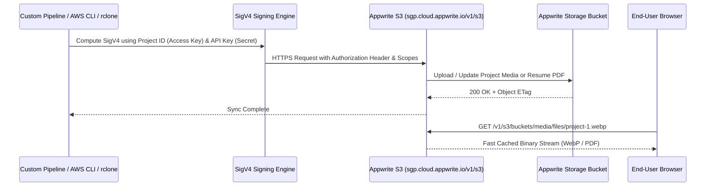

# Architecture Specification (`Architecture.md`)

## Project: Vikas Dhavande Personal Portfolio & Systems Platform
- **Lead Engineer:** Vikas Dhavande
- **Positioning:** Senior Full Stack & AI Systems Engineer
- **Profiles:** [LinkedIn](https://www.linkedin.com/in/vikas-dhavande/) | [GitHub](https://github.com/vikas-dhavande)
- **Architecture Type:** Jamstack / Hybrid Edge with Managed Backend-as-a-Service (Appwrite Cloud)

---

## 1. High-Level System Architecture

The application is engineered as a decoupled, hybrid-rendered platform combining the performance of Next.js 14 App Router (React Server Components) with the reliability and scalability of Appwrite Cloud (Singapore Region).

```mermaid
graph TD
    User([End User / Recruiter / Client]) --> EdgeCDN[Vercel Global Edge Network]
    EdgeCDN --> NextRuntime[Next.js App Router (RSC Runtime)]
    
    subgraph Frontend Application Layer [Frontend Application Layer (Next.js 14)]
        NextRuntime --> RootLayout[Root Layout + Next-Themes]
        RootLayout --> Nav[Sticky Navbar & Theme Switcher]
        RootLayout --> Page[Main Portfolio Page]
        
        Page --> Hero[Hero & Identity Section]
        Page --> Projects[Projects Showcase]
        Page --> Experience[Experience Timeline]
        Page --> Skills[Skills & Systems Matrix]
        Page --> Reactions[Reactions & Comments Bar]
        Page --> Contact[Interactive Contact Form]
    end

    subgraph Appwrite Cloud BaaS Layer [Appwrite Cloud (Singapore - sgp)]
        AppwriteEndpoint["Appwrite API Gateway (https://sgp.cloud.appwrite.io/v1)"]
        
        subgraph Appwrite Auth [Appwrite Auth Engine]
            OAuth[OAuth 2.0 Providers<br/>Google | GitHub | LinkedIn]
            UserSessions[(Active User Sessions)]
        end

        subgraph Appwrite Storage (S3-Compatible) [Appwrite Storage]
            S3Gateway["S3-Compatible Endpoint (https://sgp.cloud.appwrite.io/v1/s3)"]
            BucketMedia[(Media Bucket)]
            BucketResumes[(Resumes & PDF Bucket)]
            SigV4[SigV4 Authentication Engine]
        end
        
        subgraph Appwrite Databases & Realtime [Appwrite Databases & Realtime]
            DB[(Portfolio Database)]
            CollProjects[Projects Collection]
            CollInquiries[Inquiries Collection]
            CollComments[Comments Collection]
            CollReactions[Reactions Collection]
            RealtimeWS[Realtime WebSocket Engine]
        end
    end

    subgraph Agent & Developer Infrastructure [Agent & MCP Infrastructure]
        AppwriteMCP["Appwrite MCP Server (https://mcp.appwrite.io)"]
        SkillsCLI["Appwrite Skills CLI (appwrite/skills)"]
        Rclone["Storage Tooling (rclone / AWS CLI)"]
    end

    Nav -->|OAuth Trigger| OAuth
    Page -->|Server-side fetch / Hydration| AppwriteEndpoint
    Projects -->|Images & Diagrams| S3Gateway
    Hero -->|Resume PDF Download| S3Gateway
    Contact -->|Form Submission API| CollInquiries
    Reactions -->|Post Comment / Toggle Reaction| DB
    Reactions <-->|Live Updates| RealtimeWS
    AppwriteMCP <--> AppwriteEndpoint
    Rclone <--> S3Gateway
    S3Gateway --- SigV4
```

---

## 2. Server vs. Client Component Boundaries

To optimize performance and minimize client JavaScript bundle size:

```mermaid
flowchart TD
    subgraph Server Components (Zero-JS Payload)
        RSC_Layout[RootLayout: fonts, HTML head, metadata injection]
        RSC_Page[HomePage: server-side data fetching & SEO markup]
        RSC_Hero[HeroSection: static bio and role headlines]
        RSC_Projects[ProjectsGrid: static markup rendering from Appwrite/fallback]
        RSC_Experience[ExperienceTimeline: static history markers]
        RSC_Skills[SkillsMatrix: badge categorization]
    end

    subgraph Client Components ("use client" - Interactivity Only)
        CC_Theme[ThemeToggle: local preference & system detection]
        CC_Contact[ContactForm: state validation & toast feedback]
        CC_MobileNav[MobileNav: sheet drawer toggle]
        CC_ProjectModal[ProjectPreview: interactive dialog inspection]
    end

    RSC_Layout --> CC_Theme
    RSC_Page --> CC_Contact
    RSC_Page --> CC_MobileNav
    RSC_Projects --> CC_ProjectModal
```

---

## 3. Appwrite S3-Compatible Storage Pipeline

Appwrite provides project-scoped S3-compatible endpoints with AWS Signature Version 4 (SigV4) support:



### Key Storage Specifications:
- **Project ID (Access Key):** `6accb26e001f6cc8b769`
- **Host / Region:** `https://sgp.cloud.appwrite.io/v1/s3` (`sgp`)
- **Required Storage API Key Scopes:**
  - `buckets.read`
  - `buckets.write`
  - `files.read`
  - `files.write`

---

## 4. Data Flow & Resilience Strategy

1. **Static Fallback Data Store (`src/data/portfolio.ts`):** Contains guaranteed baseline data for Vikas Dhavande (bio, experiences, core projects, skills).
2. **Appwrite Dynamic Enrichment:** When Appwrite credentials are present, Route Handlers and Server Components query the live collections to fetch latest updates.
3. **Graceful Degradation:** If network or API limits are encountered, the site automatically serves cached/static records with zero downtime or user-facing error screens.

---

## 5. Security & Edge Delivery Architecture

- **Zero Secret Exposure:** All Appwrite API keys with write scopes remain strictly server-side inside Next.js Route Handlers.
- **Edge Caching:** Static assets and generated pages are distributed across global edge nodes with automated cache invalidation.
- **Strict CSP:** Content Security Policy configured to permit Appwrite assets (`https://sgp.cloud.appwrite.io`) without opening script execution holes.
