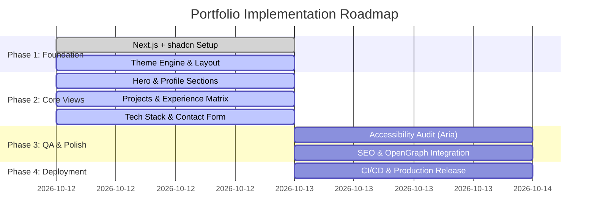

# Product Requirements Document (PRD)

## Project: Vikas Dhavande Personal Portfolio & Engineering Platform
**Author:** Vikas Dhavande  
**Version:** 1.0.0  
**Status:** In Progress / Active  
**Stack Foundation:** Next.js 14+ (App Router), TypeScript, Tailwind CSS, shadcn/ui (Preset `b0`, Base `aria`)

---

## 1. Executive Summary & Vision

The Vikas Dhavande Engineering Portfolio is a high-performance, developer-centric digital presence designed to showcase engineering expertise, full-stack capabilities, cloud architecture experience, and AI systems solutions. 

The primary goal is to present a polished, authoritative, and responsive portfolio that delivers seamless navigation, fast initial page loads, intuitive interactivity, and accessible dual-theme ergonomics.

---

## 2. Target Audience & Personas

| Persona | Motivation | Key Expectations |
| :--- | :--- | :--- |
| **Engineering Managers & Tech Leads** | Evaluating technical depth, architectural mindset, and code quality. | Clear technical breakdowns, production achievements, architecture diagrams, GitHub links. |
| **Technical Recruiters** | Quickly verifying role alignment, skill competencies, and contact reach. | Concise summary, downloadable/viewable resume, highlighted core competencies, LinkedIn/email. |
| **Startup Founders & Clients** | Seeking an end-to-end builder to bring complex ideas into production. | Case studies, product demos, full-stack capability proof, calendar scheduling. |
| **Developer Community & Peers** | Reading technical insights, open-source work, and design references. | Clean UI, modern design tokens, interactive components, responsive layout. |

---

## 3. Product Goals & Key Performance Indicators (KPIs)

- **Performance Excellence:** Lighthouse score 95+ across Performance, Accessibility, Best Practices, and SEO.
- **Sub-Second First Contentful Paint (FCP):** Under 1.0s on standard 4G and desktop broadband.
- **Flawless Responsiveness:** 100% fluid UX across mobile devices (320px+), tablets, laptops, and ultra-wide displays.
- **Conversion Optimization:** Clear CTAs for scheduling calls, initiating contact, reviewing repositories, and connecting on LinkedIn.
- **Zero Accessibility Barriers:** WCAG 2.1 Level AA compliance across color contrasts, screen reader labels, keyboard navigation, and Aria attributes.

---

## 4. Feature Specifications & Requirements

### 4.1 Hero & Identity Section
- **Dynamic Headline & Pitch:** Clear role positioning ("Full Stack Engineer & System Architect").
- **Bio Summary:** Focused on scalable software, distributed systems, and modern AI application engineering.
- **Direct Actions:** "View Projects", "Contact Me", and "Schedule a Call" buttons.
- **Social Matrix:** Verified links to GitHub (`@vikas-dhavande`), LinkedIn, X / Twitter, and direct email.
- **Visual Avatar:** High-resolution portrait optimized with responsive sizes and modern aspect ratio.

### 4.2 Featured Projects Showcase
- **Curated Project Cards:** Showcase top full-stack and architectural projects.
- **Metadata Badges:** Technologies used (e.g., Next.js, TypeScript, PostgreSQL, Docker, Tailwind).
- **Interactive Links:** Direct buttons for Live Demo preview, GitHub Source code, and Case Study breakdown.
- **Media Previews:** High-quality imagery, video previews, or architectural diagrams.

### 4.3 Professional Experience Timeline
- **Chronological Milestones:** Reverse chronological display of engineering roles and tenures.
- **Quantifiable Impact:** Bulleted metrics outlining latency reduction, throughput improvements, and architectural achievements.
- **Company & Context:** Clear role labels, team scope, and primary tech stack utilized per position.

### 4.4 Technical Stack & Skills Matrix
- **Category Grouping:**
  - *Frontend & Interface:* Next.js App Router, React, TypeScript, Tailwind CSS, shadcn/ui, State Management.
  - *Backend & Distributed Systems:* Node.js, Python, REST & GraphQL APIs, Microservices, PostgreSQL, Prisma/Drizzle.
  - *DevOps & Cloud:* Docker, CI/CD GitHub Actions, Vercel, AWS/GCP essentials, Performance Tuning.
  - *AI & Intelligent Workflows:* LLM Integration, RAG Pipelines, Autonomous Agent Architectures.
- **Proficiency & Contextual Indicators:** Interactive badge components and descriptive skill tags.

### 4.5 Dual Theme & Accessibility Engine
- **Light/Dark Toggle:** Clean dual-mode support with immediate persistent toggle via `next-themes` and system default detection.
- **Aria Base Semantics:** Fully accessible primitives using shadcn/ui Aria base preset (`b0`), providing proper `aria-expanded`, `aria-hidden`, keyboard navigation, and semantic HTML5 elements.

### 4.6 Contact & Connection Hub
- **Interactive Form / Contact Channels:** Direct email trigger, calendar scheduler integration, and copy-to-clipboard email utility.
- **Response Confirmation:** Visual toast notification upon copying email or submitting messages.

---

## 5. Non-Functional Requirements (NFR)

- **Security:** Zero client-side leak of secrets, strict CSP headers, sanitized inputs.
- **SEO & Social Graphs:** Automated OpenGraph (OG) image generation, dynamic meta tags, JSON-LD structured schema for `Person` and `WebSite`.
- **Maintainability:** Modular component hierarchy, decoupled configuration in clean data structures, and typed props throughout.
- **Cross-Browser Compatibility:** Support for all modern Chromium, WebKit, and Gecko browsers (Chrome, Edge, Safari, Firefox).

---

## 6. Implementation Milestones

