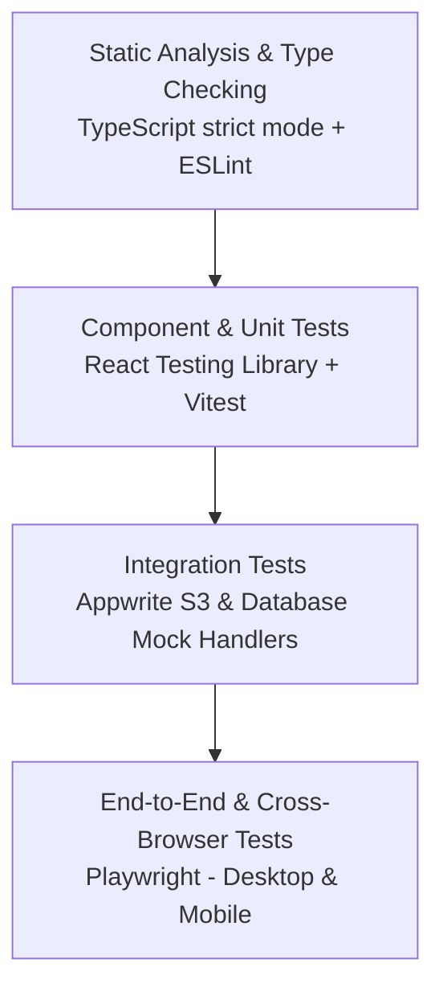

# Testing Strategy & Quality Assurance (`Testing.md`)

## Project: Vikas Dhavande Personal Portfolio & Systems Platform
- **Lead / Owner:** Vikas Dhavande
- **Positioning:** Senior Full Stack & AI Systems Engineer
- **Quality Standard:** Continuous Verification / Automated CI Gates
- **Document Version:** 1.0.0

---

## 1. Testing Philosophy & Verification Pyramid

Quality assurance follows a structured testing pyramid ensuring high velocity, deterministic feedback, and zero regression in production.



---

## 2. Test Layers & Specifications

### 2.1 Layer 1: Static Analysis & Type Checking
- **TypeScript:** Strict type checking ensuring zero implicit `any` types.
  ```bash
  npx tsc --noEmit
  ```
- **Linting:** ESLint with Next.js Core Web Vitals rules.
  ```bash
  npm run lint
  ```

### 2.2 Layer 2: Component & Unit Testing
- **Framework:** Vitest + React Testing Library + `@testing-library/jest-dom`.
- **Target Areas:**
  - Theme toggler state transitions (`light` ↔ `dark`).
  - Project card rendering with tags and external links.
  - Contact form client-side validation logic.
  - Fallback data resolution when backend returns empty.

### 2.3 Layer 3: Appwrite Integration Verification
Validates connectivity with Appwrite Cloud (`sgp` region):
- **Storage Connectivity:** Verification of S3 SigV4 handshake and signed URL resolution.
  ```bash
  # Verify Appwrite S3 endpoint reachable
  curl -I https://sgp.cloud.appwrite.io/v1/s3
  ```
- **Database Query Validation:** Verifying `/api/inquiries` correctly persists inquiry records.

### 2.4 Layer 4: End-to-End (E2E) Testing with Playwright
- **Coverage Matrix:**
  - Chromium (Desktop Chrome)
  - Firefox
  - WebKit (Desktop Safari)
  - Mobile Chrome (Pixel 7 emulation)
  - Mobile Safari (iPhone 14 emulation)
- **Critical User Flows:**
  1. *Navigation Flow:* Header anchor links navigate smoothly to sections (`#projects`, `#experience`, `#skills`, `#contact`).
  2. *Theme Toggle:* Clicking theme switcher updates HTML class attribute without flash or layout shift.
  3. *Resume Access:* Clicking resume download triggers valid S3 asset stream.
  4. *Inquiry Flow:* Filling and submitting the contact form produces the success toast notification.

---

## 3. Automated Accessibility Testing (a11y)

- **Engine:** `@axe-core/playwright`
- **Rule Set:** WCAG 2.1 Level AA
- **Assertions:**
  - Zero critical or serious accessibility violations.
  - All form controls have associated accessible labels.
  - Color contrast ratios exceed `4.5:1` in both Light and Dark modes.
  - All buttons and links receive visible focus rings on Tab key press.

---

## 4. Performance & Core Web Vitals Auditing

Lighthouse CI runs on every production pull request:

| Metric | Target Budget | Enforcement Action |
| :--- | :--- | :--- |
| **Performance** | `>= 95` | PR Blocked if below |
| **Accessibility** | `100` | PR Blocked if below |
| **Best Practices**| `100` | PR Blocked if below |
| **SEO** | `100` | PR Blocked if below |
| **FCP (First Contentful Paint)** | `< 1.0s` | Warning if exceeded |
| **LCP (Largest Contentful Paint)**| `< 1.8s` | PR Blocked if exceeded |
| **CLS (Cumulative Layout Shift)**| `0.00` | PR Blocked if exceeded |

---

## 5. CI Execution Commands Summary

```bash
# 1. Type validation
npm run type-check   # npx tsc --noEmit

# 2. Linting
npm run lint

# 3. Unit & Component tests
npm run test:unit

# 4. E2E tests
npx playwright test

# 5. Production build test
npm run build
```
