# Design System Specification (`design.md`)

## Project: Vikas Dhavande Personal Portfolio & Systems Platform
**Design System Foundation:** shadcn/ui (Preset `b0`, Base `aria`) + Tailwind CSS + OKLCH Tokens  
**Version:** 1.0.0  

---

## 1. Design Philosophy

The Vikas Dhavande portfolio design balances **editorial minimalism** with **technical precision**:
1. **Clean Dual-Mode Aesthetics:** Engineered with seamless Light and Dark modes. Dark mode delivers low eye strain with soft contrast, while Light mode is crisp and paper-clean.
2. **Perceptually Uniform Color (OKLCH):** Uses the OKLCH color model to guarantee predictable lightness, chroma, and hue across theme transformations.
3. **Intentional Micro-Interactions:** Subtle, high-performance CSS transitions (`150ms-250ms`) on hover, focus, and state changes. No gratuitous motion that compromises responsiveness.
4. **Accessible by Default:** All interactive primitives are powered by W3C WAI-ARIA standards with high-visibility focus rings and keyboard traversal.

---

## 2. Color Palette & OKLCH Design Tokens

The system is configured with the **b0** preset design tokens:

### 2.1 Light Theme Tokens (`:root`)
```css
:root {
  --background: oklch(1 0 0);                    /* Pure white foundation */
  --foreground: oklch(0.145 0 0);                /* Deep carbon text */
  --card: oklch(1 0 0);                          /* Clean card surface */
  --card-foreground: oklch(0.145 0 0);           /* Card text */
  --popover: oklch(1 0 0);                       /* Dropdown & popover surface */
  --popover-foreground: oklch(0.145 0 0);        /* Popover text */
  --primary: oklch(0.205 0 0);                   /* Dark primary action button */
  --primary-foreground: oklch(0.985 0 0);        /* High contrast primary text */
  --secondary: oklch(0.97 0 0);                  /* Subtle secondary action */
  --secondary-foreground: oklch(0.205 0 0);      /* Secondary action text */
  --muted: oklch(0.97 0 0);                      /* Soft neutral background */
  --muted-foreground: oklch(0.556 0 0);          /* De-emphasized subtitle text */
  --accent: oklch(0.97 0 0);                     /* Accent hover highlight */
  --accent-foreground: oklch(0.205 0 0);         /* Accent hover text */
  --destructive: oklch(0.577 0.245 27.325);      /* Semantic alert / error red */
  --border: oklch(0.922 0 0);                    /* Crisp border separator */
  --input: oklch(0.922 0 0);                     /* Form field boundary */
  --ring: oklch(0.708 0 0);                      /* Focus outline ring */
  --radius: 0.625rem;                            /* 10px standard corner radius */
}
```

### 2.2 Dark Theme Tokens (`.dark`)
```css
.dark {
  --background: oklch(0.145 0 0);                /* Charcoal obsidian canvas */
  --foreground: oklch(0.985 0 0);                /* Pure soft white text */
  --card: oklch(0.205 0 0);                      /* Elevated dark card */
  --card-foreground: oklch(0.985 0 0);           /* Card content text */
  --popover: oklch(0.205 0 0);                   /* Dark popover surface */
  --popover-foreground: oklch(0.985 0 0);        /* Popover text */
  --primary: oklch(0.922 0 0);                   /* High-contrast primary action */
  --primary-foreground: oklch(0.205 0 0);        /* Dark primary text */
  --secondary: oklch(0.269 0 0);                  /* Elevated secondary action */
  --secondary-foreground: oklch(0.985 0 0);      /* Secondary action text */
  --muted: oklch(0.269 0 0);                     /* Subdued dark background */
  --muted-foreground: oklch(0.708 0 0);          /* Balanced secondary text */
  --accent: oklch(0.269 0 0);                    /* Dark accent hover */
  --accent-foreground: oklch(0.985 0 0);         /* Dark accent text */
  --destructive: oklch(0.704 0.191 22.216);      /* Vibrant dark mode red */
  --border: oklch(1 0 0 / 10%);                  /* 10% translucent border */
  --input: oklch(1 0 0 / 15%);                   /* 15% translucent input border */
  --ring: oklch(0.556 0 0);                      /* Distinct dark focus ring */
}
```

---

## 3. Typography & Hierarchy

The portfolio uses the **Inter** / **Geist Sans** font family paired with **Geist Mono** for code and technical tags.

| Role | Tailwind Classes | Size / Line Height | Tracking | Usage |
| :--- | :--- | :--- | :--- | :--- |
| **Hero Display** | `text-4xl md:text-6xl font-bold` | `3.75rem / 1.1` | `-0.025em` | Main hero greeting and name |
| **Section Title**| `text-2xl md:text-3xl font-semibold`| `1.875rem / 1.25`| `-0.02em` | Projects, Experience, Skills headings |
| **Card Heading** | `text-lg md:text-xl font-medium` | `1.25rem / 1.4` | `-0.01em` | Individual project & company titles |
| **Body Primary** | `text-base font-normal` | `1.0rem / 1.6` | `0` | Biographies, impact statements |
| **Body Secondary**| `text-sm text-muted-foreground` | `0.875rem / 1.5` | `0` | Timestamps, locations, sublines |
| **Code / Badges**| `font-mono text-xs` | `0.75rem / 1.4` | `+0.02em` | Tech stack tags, metadata badges |

---

## 4. Spacing, Layout & Grid System

- **Max Container Width:** `max-w-4xl` (768px - 896px) for an elegant, focused reading flow.
- **Section Padding:** `py-16 md:py-24` ensuring distinct visual breathing room between sections.
- **Grid Patterns:**
  - *Projects Grid:* 1 column on mobile (`grid-cols-1`), 2 columns on desktop (`md:grid-cols-2`), gap `gap-6`.
  - *Skills Matrix:* Responsive flexible tag badges with `flex flex-wrap gap-2`.
- **Card Radius:** Standard `rounded-xl` (`0.625rem`) mirroring `--radius`.

---

## 5. Key Component Specs

```mermaid
classDiagram
    class Navbar {
        +Sticky blur background
        +Brand logo / initials
        +Navigation links (Projects, Experience, Skills, Contact)
        +ThemeToggle button
    }
    class ProjectCard {
        +Image / Demo thumbnail
        +Project Title & Description
        +Tech badge list
        +GitHub & Live Demo action links
    }
    class ExperienceTimeline {
        +Chronological line marker
        +Company name & role title
        +Tenure timestamp
        +Bulleted quantified achievements
    }
    class TechBadge {
        +Icon / Logo
        +Technology title
        +Subtle border & hover glow
    }
    class ContactSection {
        +Direct email CTA
        +Calendar scheduler link
        +Social media icon group
    }
    class HairlineSemiconductorFigure {
        +Isometric SVG silicon die & bus traces
        +Pointer tracking & coordinate projection
        +Responsive viewBox & stroke scaling
        +Smooth rest pose & active animation
    }
    class Blobatar {
        +Deterministic string hasher (name/id seed)
        +Organic cubic spline control points
        +Vibrant gradient color palette
        +Interactive hover animation and facial expressions
    }
```



---

## 6. Accessibility & WAI-ARIA Standards

- **Focus Rings:** `focus-visible:outline-none focus-visible:ring-2 focus-visible:ring-ring focus-visible:ring-offset-2`.
- **Contrast Ratios:** All text-to-background combinations meet or exceed `4.5:1` for normal text and `3:1` for large text.
- **Screen Reader Support:** Decorative icons are marked with `aria-hidden="true"`, while interactive action buttons include descriptive `aria-label` tags.
